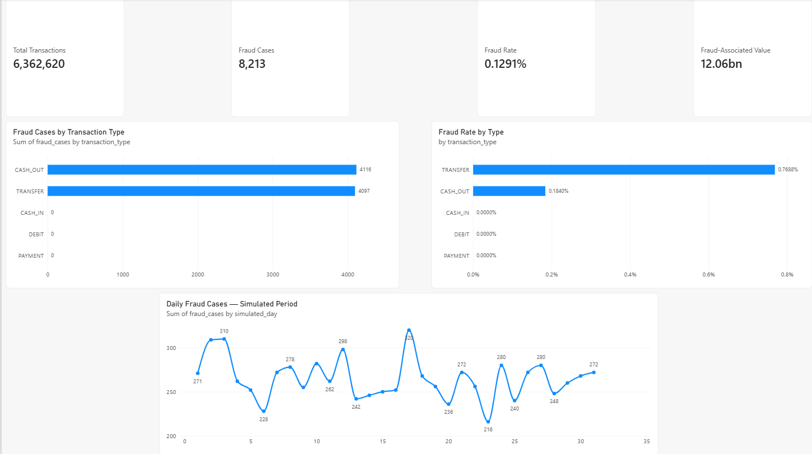
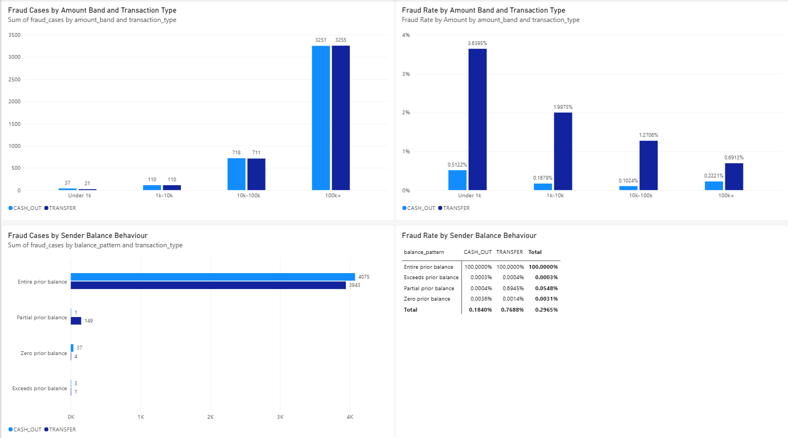
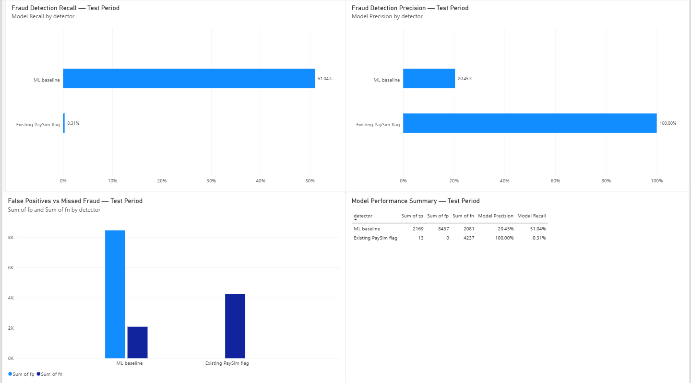
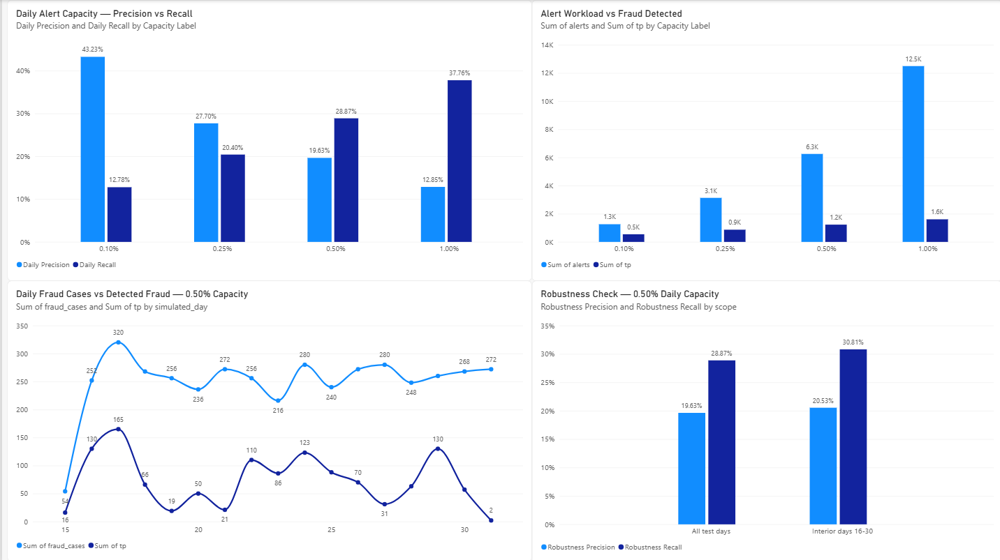

# Banking Fraud Detection & Risk Analytics

### End-to-end analytics, machine-learning evaluation and investigation-capacity planning

**Python · DuckDB / SQL · pandas · scikit-learn · Power BI · DAX · GitHub**

> **Portfolio case study — synthetic data, not a live banking system.** This project investigates labelled fraud in the public PaySim mobile-money simulation, compares baseline detection methods, and studies the cost of operating under fixed investigation capacity. No real customer data, confirmed financial losses, production deployment, or realised business impact is claimed.

## Project at a glance

| Measure | Verified result |
|---|---:|
| Simulated transactions audited | **6,362,620** |
| Labelled fraudulent transactions | **8,213** |
| Overall fraud prevalence | **0.1291%** |
| Simulated transaction amount associated with labelled fraud | **12.06 billion units** |
| Existing PaySim fraud flags | **16** |
| Later-period ML test: precision / recall | **20.45% / 51.04%** |
| Later-period ML test: average precision | **0.2970** |
| Daily retrospective top-K, 0.50% capacity: precision / recall | **19.63% / 28.87%** |

**Business question:** How can we identify potentially fraudulent transactions while making efficient use of a limited investigation team?

## Dashboard — four-page preview

The complete interactive [Banking Fraud Risk Dashboard (.pbix)](dashboards/Banking_Fraud_Risk_Dashboard.pbix) opens in Power BI Desktop. GitHub cannot render the interactive report in-browser; the images below are previews.

### 1. Fraud Risk Overview
Transaction volume, labelled fraud, fraud-associated simulated value, transaction types and simulated-day trends.

### 2. Transaction Behaviour
Fraud counts and rates by amount band, transaction type, and prior-balance behaviour.

### 3. Fraud Detection Performance
Machine-learning precision and recall versus the supplied PaySim fraud flag, with false-positive and missed-fraud counts.

### 4. Investigation Capacity
Daily alert quotas, precision/recall trade-offs, fraud cases detected by simulated day, and boundary-period sensitivity.

## Selected findings

**Transaction types:** All 8,213 labelled frauds appear in \`TRANSFER\` (4,097; **0.7688%** of transfers) or \`CASH_OUT\` (4,116; **0.1840%** of cash-outs). More cases do not necessarily mean a higher rate.

**Transaction amounts:** **6,506 fraud cases (79.2%)** involve amounts of at least 100,000 synthetic units, although the *highest observed fraud rate* is **3.6395%** for transfers under 1,000 units (21 of 577 transfers).

**Exploratory balance rule:** **8,018** labelled frauds occurred in transactions that matched the sender's full recorded prior balance; all 8,018 such transactions in this dataset were labelled fraudulent. This rule achieved **97.63% in-sample recall** with zero in-sample false positives. **It was discovered after inspecting the dataset and is not independently validated.** This highly distinctive pattern likely reflects PaySim's simulation mechanism.

**Machine-learning baseline:** A \`HistGradientBoostingClassifier\` trained on earlier steps, using transaction type, amount and simulated time **without account-balance features**, detected **2,169 of 4,250** labelled frauds in the later period (**51.04% recall, 20.45% precision**) while generating **8,437 false positives**. The supplied PaySim flag detected **13** test-period frauds with no false positives (0.31% recall).

**Investigation capacity:** At a retrospective top-**0.50% per simulated day** quota, **6,251** alerts included **1,227** labelled frauds (19.63% precision, 28.87% recall). Ranking across the *whole test period* instead found **1,961** frauds within **6,244** alerts (31.41% precision, 46.14% recall); that more optimistic allocation requires knowledge of scores across the whole future period.

**Sensitivity:** Excluding incomplete boundary days 15 and 31 changed the 0.50%-daily-capacity result to **20.53% precision / 30.81% recall**. Day 31 has 272 transactions and all 272 are labelled fraud, a dataset/simulation anomaly that must be disclosed.

[**Read the full business investigation, recommendations and limitations**](reports/Banking_Fraud_Investigation_Report.md)

## Method and evaluation design

1. Audit the CSV using **DuckDB** so millions of transactions need not be loaded into a spreadsheet.
2. Profile fraud by transaction type, amount band, time step and sender-balance pattern.
3. Compare the supplied \`isFlaggedFraud\` indicator with an exploratory full-balance rule.
4. Define a **chronological partition**: model-training steps **1–282**; validation steps **283–355**; later-period testing steps **356–743**.
5. Fit a histogram gradient-boosting classifier using **all training-period labelled fraud** and a deterministic **15% sample of training-period legitimate TRANSFER/CASH_OUT candidates**. All transaction types and rows remain in validation and testing.
6. Select a fixed-score operating threshold from validation data; separately compare fixed whole-period and daily **top-K** alert budgets.
7. Validate the confusion-matrix arithmetic and examine exclusion of boundary days.
8. Export aggregate CSVs and visualise in Power BI. Tables have different aggregation grains and must not be indiscriminately joined.

**Model features:** log(transaction amount), simulated step, transfer indicator, and simulated hour-of-day. **Not used as ML features:** pre/post balances, account IDs, fraud labels, and \`isFlaggedFraud\`.

**Interpretation warning:** The entire PaySim dataset was explored before the ML baseline was designed (including the test period), so the later-period results are useful **retrospective chronological evaluation**, **not a pristine, independently untouched holdout**. Sampled legitimate training records also make the model scores **uncalibrated** as fraud probabilities.

## Reproduce the analysis

### 1. Download the public input

Obtain the [PaySim dataset from Kaggle](https://www.kaggle.com/datasets/ealaxi/paysim1). Place the extracted file at:

\`\`\`text
data/raw/PS_20174392719_1491204439457_log.csv
\`\`\`

The raw ~493 MB CSV is deliberately excluded from GitHub. Do not commit personal financial data or generated model files.

### 2. Install dependencies

From the repository root in PowerShell (Windows):

\`\`\`powershell
py -m venv .venv
& ".\.venv\Scripts\python.exe" -m pip install -r requirements.txt
\`\`\`

### 3. Generate the analysis outputs

Run in this order because downstream scripts read files written by earlier scripts:

\`\`\`powershell
$py = ".\.venv\Scripts\python.exe"
& $py src/audit_paysim.py
& $py src/fraud_profile.py
& $py src/fraud_patterns.py
& $py src/balance_patterns.py
& $py src/rule_baseline.py
& $py src/chronological_validation.py
& $py src/train_fraud_baseline.py
& $py src/threshold_analysis.py
& $py src/fixed_capacity_analysis.py
& $py src/daily_alert_capacity.py
& $py src/daily_robustness_check.py
& $py src/prepare_powerbi.py
\`\`\`

The scripts produce \`outputs/\` files locally and refresh the **11 compact CSVs** under \`dashboards/powerbi_data/\`. Model training and full-data scoring can require substantial memory and processing time.

Run the lightweight published-summary consistency tests:

\`\`\`powershell
& ".\.venv\Scripts\python.exe" -m pytest -q
\`\`\`

These tests validate stored summary tables; they do **not** replace a complete independent rerun from raw data.

### 4. Explore the report

Open \`dashboards/Banking_Fraud_Risk_Dashboard.pbix\` in Power BI Desktop. The report uses imported summary CSVs: if opened from another computer, Power Query's local source paths may need updating before **Refresh**. The screenshots remain viewable without Power BI.

## Repository guide

| Location | Contents |
|---|---|
| [\`src/\`](src/) | Audits, SQL profiling, exploratory rules, ML, capacity analysis and Power BI preparation |
| [\`dashboards/powerbi_data/\`](dashboards/powerbi_data/) | 11 published, compact tables for Power BI |
| [\`dashboards/screenshots/\`](dashboards/screenshots/) | Four dashboard preview images |
| [Power BI report](dashboards/Banking_Fraud_Risk_Dashboard.pbix) | Four-page \`.pbix\` file |
| [Business report](reports/Banking_Fraud_Investigation_Report.md) | Findings, recommendations, test caveats and next steps |
| [\`tests/\`](tests/) | Consistency checks for published outputs |
| \`data/raw/\`, \`outputs/\`, \`.venv/\` | Local-only, excluded from Git |

## Limitations and ethical use

PaySim is **synthetic mobile-money activity**, not an actual commercial bank's records. Money amounts have **no verified real-world currency**, and labelled fraudulent *transaction value* is **not proven loss**. The baseline cannot be treated as a deployed fraud-control system; it does not measure customer inconvenience, intervention costs, account-level leakage, or live decision latency. Its top-K analysis operates **after each simulated day** or whole period, not at transaction submission time. Further work should use a truly untouched dataset and prospectively defined model/feature choices, calibrated scores, per-hour or per-day operational quotas, and business-defined investigation-cost assumptions.

---

*Independent portfolio project based on the public PaySim simulation. Findings describe the available data and retrospective experiments, not guaranteed real-world predictive performance.*
